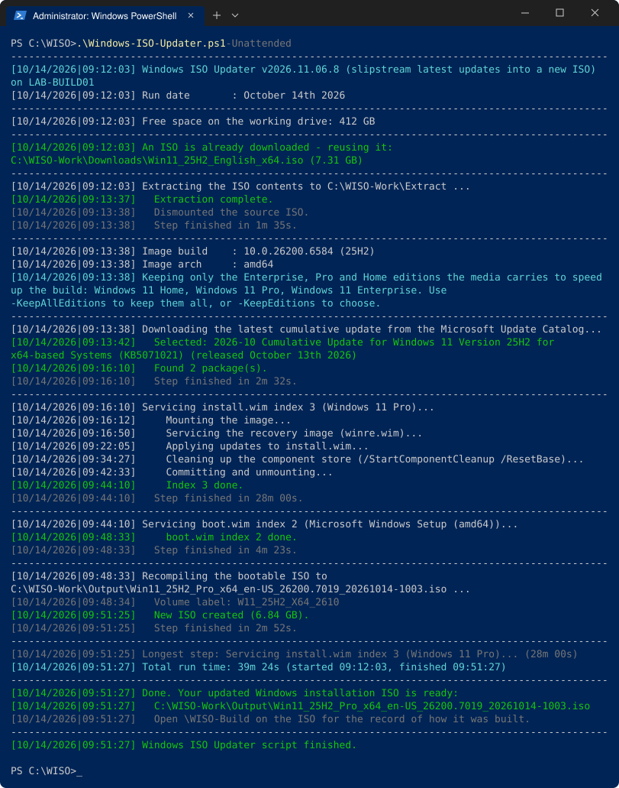
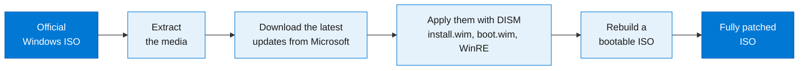

<p align="center">
  
</p>

<h1 align="center">Windows ISO Updater</h1>

<p align="center">
  <b>Turn an official Windows ISO into a fully patched one, hands-off.</b><br>
  The latest cumulative updates go straight into the image with DISM, and out comes a fresh, bootable ISO.
</p>

<p align="center">
  <a href="https://github.com/bryceforsm/Windows-ISO-Updater/releases/latest"></a>
  <a href="https://github.com/bryceforsm/Windows-ISO-Updater/actions/workflows/tests.yml"></a>
  
  
  <a href="https://github.com/bryceforsm/Windows-ISO-Updater/blob/main/LICENSE"></a>
</p>

<!-- github-only -->
<p align="center">
  <a href="#quick-start">Quick Start</a> ·
  <a href="docs/usage.md">Usage Guide</a> ·
  <a href="docs/parameters.md">Parameters</a> ·
  <a href="https://bryceforsm.github.io/Windows-ISO-Updater/">Documentation Site</a> ·
  <a href="CHANGELOG.md">Change Log</a>
</p>

<!-- /github-only -->
Installing Windows from updated media saves time by eliminating large post-installation update downloads.



## How It Works



## Key Features

* 🛡️ **Safe Execution**: All servicing happens inside a working folder (`C:\WISO-Work` by default), never on the running Windows. Outside that folder it only changes the host when asked to, with `-InstallAdk`, `-RegisterScheduledTask` or `-ExcludeWorkPathFromDefender` (Defender exclusions for the folders DISM works in, removed when the run ends), or if a mount cannot be released, when it registers a boot task that clears the mount and deletes itself.
* 🔒 **Official Sources by Default**: Downloads packages directly from Microsoft endpoints over HTTPS. The one exception is the optional `-UseFido` ISO download, which fetches a community helper from GitHub, pinned by hash.
* 🧰 **No Manual ADK Setup Needed**: Automatically fetches a verified copy of `oscdimg.exe` from Microsoft servers to compile the media.
* 🔁 **Hands-Off and Repeatable**: Run it from a [scheduled task](docs/scheduled-runs.md) or a [JSON profile](docs/usage.md#using-a-json-profile). A build stamp records what went into each ISO, so a run where nothing has changed finishes in a minute or two.
* 🧩 **Media Your Way**: Choose which editions to keep, and add an [answer file](docs/unattended-installs.md), [drivers](docs/usage.md#adding-drivers) or [your own files](docs/usage.md#adding-your-own-files-to-the-iso).
* 🧾 **A Record on Every ISO**: Each ISO carries a `\WISO-Build` folder recording what it was built from and which updates went in ([details](docs/reference.md#the-build-record-on-the-iso)).
* 🖥️ **Windows Server Support**: Compatible with Windows Server media, detected automatically from the image.
* 🔐 **Secure Boot Ready**: Microsoft's signed boot files are kept as they are, so the ISO boots with Secure Boot on ([writing it to USB](docs/usage.md#writing-the-iso-to-a-usb-stick)).

---

## Quick Start

1. Place [`Run-Windows-ISO-Updater.bat`](https://github.com/bryceforsm/Windows-ISO-Updater/releases) and [`Windows-ISO-Updater.ps1`](https://github.com/bryceforsm/Windows-ISO-Updater/releases) in the same directory.
2. Drag an official Windows ISO onto `Run-Windows-ISO-Updater.bat` and accept the administrator prompt. The tool builds from that ISO.
3. Or put the ISO in `C:\WISO-Work\Downloads`, then right-click `Run-Windows-ISO-Updater.bat` and select **Run as administrator**.
4. Confirm the build settings displayed in the console prompt.

To speed up the update and shrink the ISO, the tool removes the editions you are unlikely to need. On client media it keeps Enterprise, Pro and Home, and on Server media it keeps one edition, Standard if the ISO has it. Use `-KeepAllEditions` to keep every edition, or `-KeepEditions` to pick which ones stay.

> [!TIP]
> A build takes a while, mostly in DISM. [Speeding Up a Build](docs/usage.md#speeding-up-a-build) covers what makes the biggest difference, starting with how many editions you keep.

### Command Examples

**Unattended Custom Build:**
```bat
.\Run-Windows-ISO-Updater.bat -IsoPath "C:\ISOs\Win11.iso" -Edition "Windows 11 Pro" -Unattended
```

**Repeatable Build from a [JSON Profile](docs/usage.md#using-a-json-profile):**
```bat
.\Run-Windows-ISO-Updater.bat -ConfigPath "D:\Profiles\win11.json"
```

**Windows Server Build:**
```bat
.\Run-Windows-ISO-Updater.bat -IsoPath "C:\ISOs\Server2025.iso"
```

---

## Requirements

* Windows 10, Windows Server 2016, or newer
* PowerShell 5.1 or newer
* Administrator permissions
* Active internet connection for update retrieval
* Sufficient local storage space (at least 50 GB free recommended)
* A local disk for the working folder, not a network share or a cloud-synced folder ([why](docs/reference.md#keep-the-working-folder-on-a-local-disk))

---

## Documentation Links

<!-- github-only -->
For search and easier navigation, read the documentation at [bryceforsm.github.io/Windows-ISO-Updater](https://bryceforsm.github.io/Windows-ISO-Updater/).

<!-- /github-only -->
| Guide | What it covers |
| --- | --- |
| 📘 [Usage Guide](docs/usage.md) | Running the tool, JSON profiles, Server and LTSC media, editions, drivers, your own files, speeding up a build |
| ⚙️ [Command-Line Parameters](docs/parameters.md) | Every parameter and what it does |
| ⏰ [Scheduled Automation](docs/scheduled-runs.md) | Monthly builds from a scheduled task, build stamps and housekeeping |
| 🤖 [Unattended Setups](docs/unattended-installs.md) | The example answer files and what each one does |
| 🧠 [Architecture and Design Details](docs/design-notes.md) | Why the tool works the way it does |
| 🔧 [Technical Reference](docs/reference.md) | Each step of a run, the build record, downloads, disk space and logging |
| 📝 [Change Log](CHANGELOG.md) | What changed in each release |

## Reporting Issues

For any problem with this tool, please [submit a GitHub issue](https://github.com/bryceforsm/Windows-ISO-Updater/issues).

**Attach the logs from the run.** They show what the tool found, chose and did at each step, so an issue that includes them can usually be fixed without a round of follow-up questions. They are in the `Logs` folder under the working folder (`<WorkPath>\Logs`, or `-LogPath` if you set it). Attach these files from the run that went wrong:

* `Windows-ISO-Updater_<date>_<time>.log`, the main log
* `Windows-ISO-Updater_<date>_<time>_console.txt`, everything that appeared on screen
* The `Windows-ISO-Updater_<date>_<time>_DISM` folder, if there is one. It is only created when an update failed to apply.

Please also include:

* The command you ran, or the JSON profile if you used `-ConfigPath`
* Whether you started it from Windows PowerShell, PowerShell 7 or the `.bat` file
* Where the source ISO came from, for example the Microsoft website, the Evaluation Center or Visual Studio subscriptions

> [!NOTE]
> The logs record the computer name, your Windows user name, the make and model of the computer, and the full paths the run used. Look them over and replace anything you would rather not post before attaching them. See [Logging](docs/reference.md#logging) for what each file contains.

Issues and pull requests with no activity for 90 days are marked as stale and closed 14 days later. Any comment keeps one open.

## Feature Requests

Ideas are welcome. [Open a GitHub issue](https://github.com/bryceforsm/Windows-ISO-Updater/issues) that describes what you want to do and why the tool does not cover it today. An example of the command or setup you have in mind helps.

This tool is built to run hands off, from a single command or a scheduled task, and is kept tightly scoped to automating updated install media. Requests are weighed against that. Features that need someone at the screen, such as a graphical interface, may not be added, because they would make the tool more complex to use and to maintain without helping the automated builds it exists for.

## License

Distributed under the [MIT License](LICENSE). Third-party utilities and Microsoft updates fetched during runtime remain governed by their respective vendor terms.