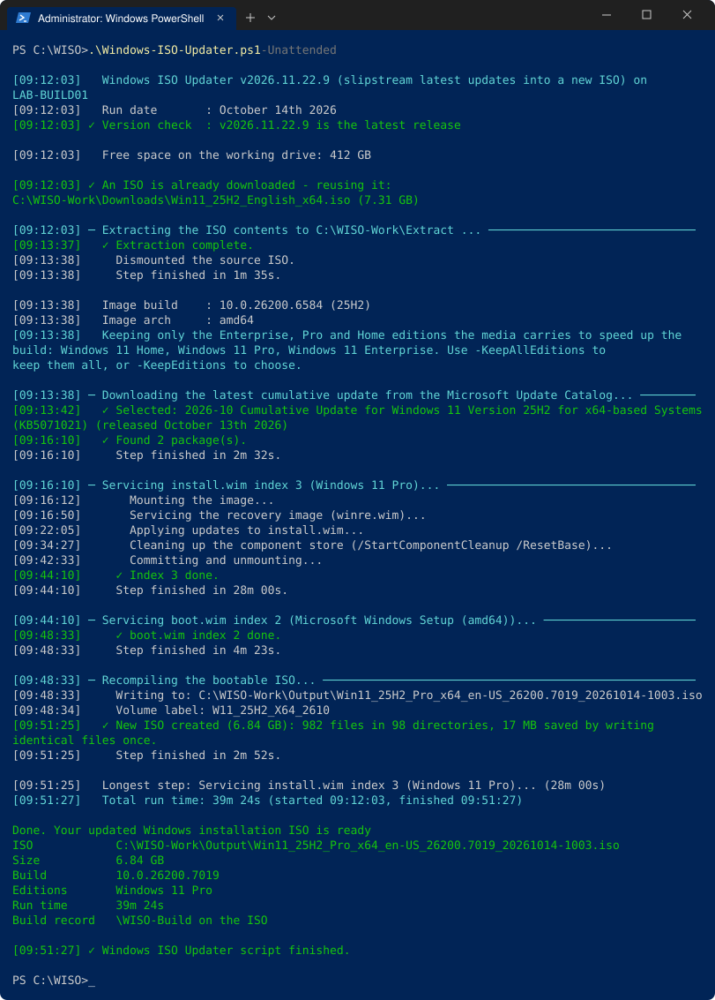
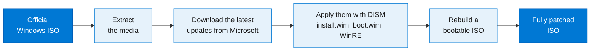

<p align="center">
  
</p>

<h1 align="center">Windows ISO Updater</h1>

<p align="center">
  <b>Turn an official Windows ISO into a fully patched one, hands-off.</b><br>
  The latest cumulative updates go straight into the image with DISM, and out comes a fresh, bootable ISO.
</p>

<p align="center">
  <a href="https://github.com/bryceforsm/Windows-ISO-Updater/releases/latest"></a>
  <a href="https://github.com/bryceforsm/Windows-ISO-Updater/actions/workflows/tests.yml"></a>
  
  
  <a href="https://github.com/bryceforsm/Windows-ISO-Updater/blob/main/LICENSE"></a>
</p>

<!-- github-only -->
<p align="center">
  <a href="#quick-start">Quick Start</a> ·
  <a href="docs/usage.md">Usage Guide</a> ·
  <a href="docs/parameters.md">Parameters</a> ·
  <a href="https://bryceforsm.github.io/Windows-ISO-Updater/">Documentation Site</a> ·
  <a href="CHANGELOG.md">Change Log</a>
</p>

<!-- /github-only -->
An ISO from Microsoft is only as current as the day it was made. Install from one a few months later and the new machine spends its first hour downloading updates, installing them and restarting, sometimes more than once. This tool fixes the media instead. Give it an official ISO and it builds a new one with the latest updates already inside, so Windows is current the moment Setup finishes.

It's a single PowerShell script with a batch file to start it. There's nothing to install, and you can read every line of what it does before you run it.



## How It Works



The updates don't just go into the Windows image. Windows Setup (`boot.wim`) and the recovery environment get theirs too, which is easy to miss when you do this by hand, and the .NET update and Setup's dynamic update come along by default.

## What You Get

**Your PC is left alone.** All the work happens in a working folder, `C:\WISO-Work` unless you choose another, and never on the Windows you're running. The tool only touches the rest of the system when you ask it to: installing the ADK with `-InstallAdk`, creating a scheduled task with `-RegisterScheduledTask`, or excluding its folders from Defender with `-ExcludeWorkPathFromDefender`, which it undoes when the run ends. The one exception is a stuck DISM mount it can't release, which it clears up with a one-time task at the next restart.

**Everything comes from Microsoft.** Updates are downloaded from Microsoft over HTTPS. So is `oscdimg.exe`, the tool that writes the ISO, which is checked against a known hash, so you don't need the Windows ADK. Each run also asks GitHub whether a newer version of this tool is out, which `-SkipVersionCheck` turns off. The only code fetched from anywhere else is for the optional `-UseFido` ISO download, a community script from GitHub pinned to a specific version and hash.

**It runs on its own.** Point a [scheduled task](docs/scheduled-runs.md) at it, or keep your settings in a [JSON profile](docs/usage.md#using-a-json-profile). Each build leaves a stamp of what went into it, so when Microsoft hasn't published anything new, the next run notices in a minute or two and stops.

**The ISO is yours to shape.** Keep only the editions you need, and add an [answer file](docs/unattended-installs.md), [drivers](docs/usage.md#adding-drivers) or [any files of your own](docs/usage.md#adding-your-own-files-to-the-iso).

**Every ISO remembers how it was made.** A `\WISO-Build` folder on the media records the source ISO, the updates that went in and the settings used ([details](docs/reference.md#the-build-record-on-the-iso)).

**Server media works too.** Windows Server ISOs are recognised from the image, with no extra settings.

**Secure Boot still works.** Microsoft's signed boot files are left exactly as they are, so the ISO boots with Secure Boot on, from a DVD, a VM or a [USB stick](docs/usage.md#writing-the-iso-to-a-usb-stick).

## Quick Start

1. Download `Run-Windows-ISO-Updater.bat` and `Windows-ISO-Updater.ps1` from the [latest release](https://github.com/bryceforsm/Windows-ISO-Updater/releases/latest) and save them in the same folder.
2. Start a build from an official Windows ISO, either way:
   * Drag the ISO onto `Run-Windows-ISO-Updater.bat`.
   * Or put the ISO in `C:\WISO-Work\Downloads`, then double-click `Run-Windows-ISO-Updater.bat`.
3. Click **Yes** on the administrator prompt. The tool continues in a new window.
4. On the first run, type `Y` to let it create its working folder, `C:\WISO-Work`. It asks only while that folder doesn't exist yet.
5. Check the summary of what the build will do, then type `Y` to start it.
6. When the build finishes, the updated ISO is in `C:\WISO-Work\Output`.

By default it keeps the editions most people actually install, which also makes the build faster and the ISO smaller. On client media that's Enterprise, Pro and Home. On Server media it's one edition, Standard if the ISO has it. Add `-KeepAllEditions` to keep everything, or `-KeepEditions` to pick.

> [!TIP]
> A build takes a while, and most of that is DISM. [Speeding Up a Build](docs/usage.md#speeding-up-a-build) covers what helps most, starting with how many editions you keep.

### A Few Examples

Build Windows 11 Pro from a specific ISO without any questions:

```bat
.\Run-Windows-ISO-Updater.bat -IsoPath "C:\ISOs\Win11.iso" -Edition "Windows 11 Pro" -Unattended
```

Build from settings you've saved in a [JSON profile](docs/usage.md#using-a-json-profile):

```bat
.\Run-Windows-ISO-Updater.bat -ConfigPath "D:\Profiles\win11.json"
```

Update a Windows Server ISO:

```bat
.\Run-Windows-ISO-Updater.bat -IsoPath "C:\ISOs\Server2025.iso"
```

## What You Need

* Windows 10, Windows Server 2016 or newer to run it on
* PowerShell 5.1, which comes with Windows. The batch file uses PowerShell 7 instead when it's installed.
* An administrator account
* An internet connection to download the updates
* About 50 GB free on a local disk for the working folder. A network share or a cloud-synced folder won't work ([why](docs/reference.md#keep-the-working-folder-on-a-local-disk)).

## Documentation

<!-- github-only -->
The same documentation is on [bryceforsm.github.io/Windows-ISO-Updater](https://bryceforsm.github.io/Windows-ISO-Updater/), with search.

<!-- /github-only -->
| Guide | What it covers |
| --- | --- |
| [Usage Guide](docs/usage.md) | Running the tool, JSON profiles, Server and LTSC media, editions, drivers, your own files, and speeding up a build |
| [Command-Line Parameters](docs/parameters.md) | Every parameter and what it does |
| [Scheduled Automation](docs/scheduled-runs.md) | Monthly builds from a scheduled task, build stamps and cleaning up old files |
| [Unattended Setups](docs/unattended-installs.md) | Answer files, and an example that finishes the updates an ISO can't carry |
| [Architecture and Design Details](docs/design-notes.md) | Why the tool works the way it does |
| [Technical Reference](docs/reference.md) | Each step of a run, the build record, downloads, disk space and logging |
| [Change Log](CHANGELOG.md) | What changed in each release |

## Reporting a Problem

If something goes wrong, please [open a GitHub issue](https://github.com/bryceforsm/Windows-ISO-Updater/issues).

**Please attach the logs from that run.** They show what the tool found, what it chose and what happened at each step, so with them most problems can be fixed without a round of questions. They're in the `Logs` folder in the working folder (`<WorkPath>\Logs`, or wherever `-LogPath` points). From the run that went wrong, attach:

* `Windows-ISO-Updater_<date>_<time>.log`, the main log
* `Windows-ISO-Updater_<date>_<time>_console.txt`, everything that appeared on screen
* The `Windows-ISO-Updater_<date>_<time>_DISM` folder, if there is one. It only exists when an update failed to apply.

It also helps to know:

* The command you ran, or your JSON profile if you used `-ConfigPath`
* Whether you started it from Windows PowerShell, PowerShell 7 or the `.bat` file
* Where the ISO came from, for example the Microsoft website, the Evaluation Center or a Visual Studio subscription

> [!NOTE]
> The logs include the computer name, your Windows user name, the computer's make and model, and the full paths the run used. Read through them and replace anything you'd rather not share before you attach them. [Logging](docs/reference.md#logging) describes what each file contains.

Issues and pull requests with no activity for 90 days are marked as stale and closed 14 days later. Any comment keeps one open.

## Ideas and Requests

Ideas are welcome. [Open a GitHub issue](https://github.com/bryceforsm/Windows-ISO-Updater/issues) that says what you're trying to do and why the tool doesn't cover it yet. An example of the command or setup you have in mind helps a lot.

The tool is meant to run without anyone watching, from one command or a scheduled task, and it sticks to one job: keeping install media up to date. Requests are weighed against that. Something that needs a person at the screen, like a graphical interface, probably won't be added. It would make the tool harder to use and maintain without helping the automated builds it exists for.

## License

The tool is released under the [MIT License](LICENSE). The Microsoft updates and third-party tools it downloads while running are covered by their own licenses.
