[← Back to README](../README.md)

# Reference

## The Run at a Glance

Everything cheap happens first, so a run that has nothing to do costs a couple of minutes rather than an hour. Amber is a decision, red stops the run, green finishes it.

```mermaid
flowchart TD
    classDef gate fill:#fff4ce,stroke:#c19c00,color:#201f1e
    classDef stop fill:#fde7e9,stroke:#c50f1f,color:#201f1e
    classDef done fill:#dff6dd,stroke:#107c10,color:#201f1e
    classDef work fill:#e5f1fb,stroke:#0f6cbd,color:#201f1e

    Start(["Windows-ISO-Updater.ps1"]) --> Admin{"Elevated, on Windows 10 or later?"}
    Admin -- "no" --> Halt1["Relaunch elevated, or stop"]
    Admin -- "yes" --> Sched{"-RegisterScheduledTask?"}
    Sched -- "yes" --> Task["Register or remove the task, exit 0"]
    Sched -- "no" --> Mutex{"Another run holding this work folder?"}
    Mutex -- "yes" --> Halt2["Stop, one run per work folder"]

    subgraph Preflight ["Pre-flight, nothing downloaded yet"]
        Sweep["Sweep an interrupted run, discard stale DISM mounts"] --> Disk{"50 GB free on the work drive?"}
        Disk -- "no" --> Halt3["Stop, pick a bigger drive with -WorkPath"]
        Disk -- "yes" --> Output{"Output folder reachable and writable?"}
        Output -- "no" --> Halt6["Stop, the finished ISO would have nowhere to go"]
        Output -- "yes" --> Validate["Validate -UnattendPath, -DriverPath and -ExtraFilesPath, parsed and never executed"]
        Validate --> Confirm{"Confirmed, or -Force?"}
        Confirm -- "no" --> Halt4["Cancelled"]
        Confirm -- "yes" --> Oscdimg["Locate oscdimg.exe, symbol server or ADK, fail fast if missing"]
        Oscdimg --> Iso["Obtain the ISO: -IsoPath, the download folder, or opt in with -UseFido or -UseMct"]
    end

    subgraph Decide ["Is there anything to do?"]
        Stamp["Compare the last-build stamp: source ISO hash, build-affecting parameters, newest KBs in the catalog"] --> Changed{"Anything changed?"}
        Changed -- "no" --> UpToDate["Already current, exit 0"]
        Changed -- "yes" --> CheckOnly{"-CheckOnly?"}
        CheckOnly -- "yes" --> Needed["Report that a rebuild is due, exit 10"]
    end

    subgraph Long ["The long part"]
        Extract["Extract the ISO with robocopy, convert install.esd to install.wim"] --> Identify["Read build, UBR, architecture and editions out of install.wim"]
        Identify --> Age{"Build 10240 or newer, and a recognised release?"}
        Age -- "no" --> Halt5["Stop, DISM cannot service it and no cumulative update exists. -SkipUpdates still repacks it"]
        Age -- "yes" --> Catalog["Fetch the LCU, the .NET update, the Setup DU and the Safe OS DU from the Microsoft Update Catalog"]
        Catalog --> Already{"Image already at that build?"}
        Already -- "yes" --> Skip["Skip the download and the integration"]
        Already -- "no" --> Editions["Pick the editions to keep and the ones to service"]
        Skip --> Editions
        Editions --> Service["Mount and service each image: install.wim, boot.wim, winre.wim, then any drivers"]
        Service --> Setup["Expand the Setup DU over sources, copy setup.exe and the boot manager out of boot.wim"]
        Setup --> Shrink["StartComponentCleanup /ResetBase, strip the residue, re-export to reclaim the space"]
    end

    subgraph Finalise ["Finish the media"]
        Files["If -UnattendPath was given, copy it on as autounattend.xml, then copy anything from -ExtraFilesPath"] --> Tattoo["Write the WISO-Build folder: the build report plus a copy of the script"]
        Tattoo --> Oscd2["oscdimg: BIOS and UEFI boot sectors, UDF, volume label"]
        Oscd2 --> Clean["Delete the working files, write the new stamp, -AutoClean old downloads"]
        Clean --> Finish(["Finished ISO plus a timing summary"])
    end

    Mutex -- "no" --> Sweep
    Iso --> Stamp
    CheckOnly -- "no" --> Extract
    Shrink --> Files

    class Admin,Sched,Mutex,Disk,Confirm,Changed,CheckOnly,Age,Already gate
    class Halt1,Halt2,Halt3,Halt4,Halt5 stop
    class Task,UpToDate,Needed,Finish done
    class Sweep,Validate,Oscdimg,Iso,Stamp,Extract,Identify,Catalog,Skip,Editions,Service,Setup,Shrink,Files,Tattoo,Oscd2,Clean work
```



## What the Script Does

1.  **Locate `oscdimg.exe`.** Downloads a standalone copy from Microsoft's symbol server if it is not already installed (or installs the ADK with `-InstallAdk`), and otherwise fails fast so the build cannot get most of the way through and then be unable to recompile the ISO.
2.  **Obtain the ISO.** Uses `-IsoPath` if given, which may be either an ISO file or a folder to pick the most recently modified `.iso` over 3 GB out of by default (not recursively, or the largest with `-UseLargestIso`, see [parameters.md](parameters.md)), otherwise the same rule picks among any already sitting in the download folder. If neither is available the run stops with instructions, because **nothing is downloaded automatically unless you ask for it** ([why](design-notes.md#why-the-iso-has-to-come-from-you)). `-UseFido` opts into downloading the matching official Microsoft ISO via the community [Fido](https://github.com/pbatard/Fido) helper (pinned by hash, verified and sandboxed in its own process, see [why it is opt-in](design-notes.md#why-the-iso-has-to-come-from-you)), retrying blocked link requests with a growing delay. `-UseMct` instead uses Microsoft's signature-verified Media Creation Tool, which is also offered interactively as a fallback. Server media is never downloaded automatically, because neither source serves it, and a run whose last build stamp records Server media says so instead of fetching a client ISO.
3.  **Extract the ISO.** Mounts the ISO and mirrors its contents into the working folder with `robocopy`, then dismounts. If the media ships `install.esd`, it is converted to an editable `install.wim`.
4.  **Find the updates.** Detects the feature update (e.g. `25H2`) and architecture from the image, which the media keeps ([why](design-notes.md#why-the-release-never-changes)), then downloads the latest combined Servicing Stack + Cumulative Update (and, by default, the .NET cumulative update, disabled with `-SkipDotNet`, and the Setup and Safe OS Dynamic Updates, both constrained to the LCU's release date, disabled with `-SkipSetupDU` and `-SkipWinRE`) from the Microsoft Update Catalog. Server media is recognised from the image and searched for the Server packages, which Microsoft titles *"Microsoft server operating system version xxHx"* from Server 2022 onwards and *"Windows Server 2016/2019"* before that. If the image is confirmed to already be at the build that cumulative update delivers, it is neither downloaded nor applied. `-UpdatePath` uses your own packages instead. The optional preview updates released late in the month are passed over unless `-IncludePreview` is used, so the media lands on the build Windows Update is currently offering rather than next month's. Two kinds of media are refused here rather than an hour later: anything older than Windows 10 and Windows Server 2016 (build 10240), which DISM on this host cannot service and which never had cumulative updates, and a Server build the script does not recognise, because the Server product name without its version matches every release and the catalog would hand back an update for the wrong one. Both can still be repacked with `-SkipUpdates`.
5.  **Integrate the updates.** Uses offline DISM to apply the package(s) to `install.wim` (by default only the kept editions, Enterprise, Pro and Home on client media or the most upgradeable single edition on Server media, overridden with `-KeepAllEditions` or `-KeepEditions`/`-Edition`), to `boot.wim` (Windows Setup / WinPE), and to `winre.wim`, which is serviced with the Safe OS Dynamic Update and then cleaned and re-exported so the recovery image does not grow (`-SkipWinRE` turns that off, and it is skipped on its own when the recovery image is already current). Each edition carries its own recovery image, but they are normally identical, so the first one is serviced and the result is reused for every later edition whose copy hashes the same. A recovery image that fails to service is reported and the build continues. The servicing stack update bundled inside the cumulative update is extracted and applied to each image first, before any update, and a standalone one supplied with `-UpdatePath` is too. If an update still fails with `0x800F0823` (*the image needs a newer servicing stack*), the bundled servicing stack is applied again and the update is retried. If DISM reports that an image can no longer be serviced, that image is discarded instead of saved, so it ships exactly as the source media had it, and the final summary lists it. If `-DriverPath` was supplied, the drivers found there go into the same install images and into `boot.wim` index 2, after the updates so an inbox driver the cumulative update brings in cannot supersede yours.
6.  **Refresh the media Setup files.** Expands the **Setup Dynamic Update** over the media's `sources` folder (updated Setup binaries, compatibility database and replacement component manifests), then copies the serviced `setup.exe`, `setuphost.exe` (Windows 11 24H2+) and boot manager files out of `boot.wim` index 2 onto the media. Windows Setup **fails during installation** if these loose files do not match the version inside `boot.wim`.
7.  **Clean up and shrink.** Runs `DISM /Cleanup-Image /StartComponentCleanup /ResetBase`, optionally strips the servicing residue DISM left inside the image with `-StripImageResidue` (CBS and DISM logs, `Windows\Temp`, `$WinREAgent`, and anything a captured source image dragged in), re-exports `install.wim` to reclaim space, and re-exports `boot.wim` (which servicing inflates), preserving the bootable flag on the Windows Setup index. With `-CompressEsd` the install image is written as `install.esd` instead, using recovery compression. See [Why Two Identical Builds Aren't the Same Size](design-notes.md#why-two-identical-builds-arent-the-same-size).
8.  **Add the answer file.** If `-UnattendPath` was supplied, copies it to the root of the media as `autounattend.xml`. Then, if `-ExtraFilesPath` was supplied, copies that folder's contents over the media, listing every file that replaced one the media already had.
9.  **Tattoo the media.** Writes a `\WISO-Build` folder onto the media describing the build, unless `-SkipTattoo` was passed. See [The Build Record on the ISO](#the-build-record-on-the-iso).
10. **Recompile the ISO.** Uses `oscdimg` to build a new bootable ISO, preserving both the **BIOS (`etfsboot.com`)** and **UEFI (`efisys.bin`)** boot sectors so the media boots on legacy and modern PCs alike. The ISO is given a volume label describing its contents, e.g. `WIN11_ENTPRO_X64_ENGB_26100_4652`, which is what File Explorer shows and what Rufus and Ventoy copy onto the USB stick. Override it with `-VolumeLabel`.
11. **Clean up.** Removes the extracted working files, leaving the finished ISO. Before they go, the run prints the build each edition's recovery image ended up at, and what each image it touched (`install.wim`, `boot.wim` and every `winre.wim` it serviced) weighed as extracted and as shipped, so the cost of the month's updates is visible rather than inferred from the ISO size.

## The Build Record on the ISO

The build stamp stays on the machine that did the building, which is no use to whoever is holding the ISO a year later, so the same story is written onto the media itself:

```text
\WISO-Build\
  build-info.txt           <- the report, readable in Notepad
  build-info.json          <- the same data for scripts
  Windows-ISO-Updater.ps1  <- the exact script that built the ISO
```

It costs about half a megabyte, Windows Setup ignores it, and deleting it off a USB stick changes nothing. It records:

- **The source media**, by file name, SHA-256, version, feature update, architecture, language and the full list of editions it shipped with, each with its original index.
- **The finished image's own locale** (for example `es-ES`, `ko-KR`, `en-US`), read from the offline registry of the serviced image while it is mounted, since a WIM's own metadata only ever reflects the language it was captured with.
- **The build of every serviced edition**, read from each one while it was mounted, so an edition whose cumulative update failed shows the build it really shipped at.
- **Every update**, by KB, role (`LCU`, `Checkpoint`, `DotNet`, `SetupDU`, `SafeOS`, or `Supplied` for `-UpdatePath` packages) and SHA-256, the catalog entry each was chosen from with its full title, and the result of applying each one to each image, so a package that failed on `boot.wim` but applied to `install.wim` is visible without digging through `dism.log`. A checkpoint update that DISM pulled in alongside the cumulative update is listed against it.
- **The recovery image**: whether it was serviced (and if not, why), the Safe OS update used, and the build each edition's `winre.wim` started and finished at.
- **Image sizes**: what `install.wim`, `boot.wim` and each serviced `winre.wim` weighed as extracted and as shipped.
- **What was kept and what was stripped**: the editions kept, the editions removed, any edition left in the ISO that was not updated, whether the component store was reset, and how much servicing residue was deleted.
- **Any drivers injected** with `-DriverPath`: the source folder, a hash of its contents, every `.inf` that went in, and whether unsigned drivers were accepted.
- **Any files added** with `-ExtraFilesPath`: the source folder, a hash of its contents, and every file that was copied with its size, SHA-256, and whether it replaced something the media already had.
- **Who built it**: machine name, user, operating system, PowerShell version, the operator's own locale (thread culture, UI culture and system locale), script version and the command line that was used. `-AnonymousTattoo` leaves out the machine name, user, script path, command line and log path, and shortens the driver, extra files and update folders to their last component, for media you hand to other people.
- **When** the run started and when the record was written, as local time with its UTC offset (for example `2026-10-02T19:07:37-07:00`). The record goes on just before `oscdimg` runs, so the ISO itself is finished a few minutes later.

`build-info.json` carries the same data with real types: switches are `true` or `false`, anything unused is `null`, and lists stay lists even with one entry. Its `SchemaVersion` is `2`. Records written before that field existed are version 1, which stored these values as display strings.

Pass `-SkipTattoo` to leave the media untouched. The switch is build-affecting, so toggling it forces one rebuild.

## How Files Are Downloaded

- The **ISO** link is resolved by the third-party **Fido** helper, but only when you pass `-UseFido`. If you prefer not to run external code, supply your own ISO with `-IsoPath` (the default way to work), or use `-UseMct` to get the ISO from Microsoft's own signature-verified Media Creation Tool instead.
- The **updates** are located by parsing the Microsoft Update Catalog search results and its download dialog (the same technique community tools use), then downloaded directly from Microsoft's update servers.
- Downloads prefer **BITS** (resumable) and fall back to `Invoke-WebRequest`. BITS is skipped when the run cannot use it: it only transfers for a signed-in user or a service account, so a scheduled task registered with `-TaskUsername` downloads directly. A task running as SYSTEM still uses BITS. Every resolved URL is verified to point at an official Microsoft host (`microsoft.com`, `windowsupdate.com`) over HTTPS before it is downloaded.

## Disk Space Requirements

Because the download, the extracted media, the mounted image, and the re-exported image all coexist, the working drive should have at least **50 GB free**. The script checks this up front and stops if the working drive is too small, so choose a larger drive with `-WorkPath` if needed.

The shrink steps near the end of the build stage a second copy of the image beside the original, so each one re-checks free space first. If the drive has filled up, that step is skipped with a warning and the build still finishes, leaving an ISO that is just larger than it could have been.

The destination for the finished ISO is proved writable in the same pre-flight pass, before anything is downloaded. `-OutputIsoPath` takes either a full file path or a folder: anything that already exists as a folder, ends in a separator, or carries no file extension is treated as a folder, and the ISO lands there under its generated name. The script then creates that folder if it is missing, writes and deletes a probe file to confirm it really has access, and refuses to start when the folder cannot be created or written, or when an ISO already sitting at the target path is held open by something else (a mounted copy in Explorer, for example). It also warns when the output lands on a network location, since a mapped drive belongs to a logon session and may not exist when a scheduled run fires, and when the drive holding it is short on space. oscdimg only runs at the very end of a build, so these are exactly the failures that would otherwise waste the whole run.

A network destination (a UNC path or a mapped drive) is never written into directly. oscdimg builds the ISO in `OutputStaging\` under the working folder, and the finished file is copied across in one pass and its size checked before the local copy is deleted, so a share that stalls or drops halfway cannot cost hours of servicing. The build stamp, the media tattoo, `-AutoClean` and the closing summary all quote the real destination, so nothing else behaves differently. If the copy itself fails the run stops with an error and the finished ISO is left in `OutputStaging\` for you to move by hand, and any staged ISO left behind by a run that was killed is swept at the start of the next one.

Both large-file copies, the finished ISO on its way out and a source ISO on its way in, go through **robocopy** rather than `Copy-Item`: it retries a share that blips, and its unbuffered mode (`/J`) is noticeably faster than a cached copy for a file this size. They run with `/COPY:DAT`, which takes the data, attributes and timestamps and nothing else, so **permissions are never carried across in either direction**. An ISO copied onto a share picks up the permissions that share hands out, and one copied off a share lands under whatever the local folder inherits, instead of arriving with an ACL full of unresolvable server accounts.

## Where Files Are Written

Everything the script writes lives under a single working folder, which defaults to `<SystemDrive>\WISO-Work`. The script prints this layout before it asks for confirmation, so you can see exactly what it will touch:

```text
C:\WISO-Work\              <- -WorkPath (moves everything below it)
  ISO\                     <- extracted media, deleted when the build finishes
  Mount\                   <- DISM mount point
  Downloads\               <- -DownloadPath (source ISO and updates)
  Output\                  <- the finished ISO (-OutputIsoPath overrides it)
  OutputStaging\           <- only used when the ISO is bound for a network path, emptied after the copy
  Logs\                    <- -LogPath
  Stamps\                  <- -StampPath (record of each finished build, see Scheduled Runs)
```

Alongside the stamps, `Stamps\hash-cache.json` remembers the SHA-256 of the last few files the script
hashed, keyed on path, size and write time. Reading a source ISO takes minutes on slow storage, and a
stamp is only written once a build succeeds, so without this a run that failed during servicing would make
the next one re-read the whole ISO for a hash it had already calculated. Delete it any time, the worst
that happens is one extra read.

Dropping your own `.iso` into `Downloads\` is all it takes to skip the Microsoft download, with no `-IsoPath` needed. The finished ISO is written to `Output\` instead, so a previous build is never picked up as the source for the next one. `-DownloadPath`, `-LogPath` and `-OutputIsoPath` override the individual folders if you want them elsewhere. Nothing outside these folders is changed, because all servicing happens against files in the working folder, never against the running system.

### Keep the working folder on a local disk

DISM services an image by projecting it onto a folder, and that only works on a real local disk. Cloud-synced folders (OneDrive, Dropbox, Google Drive) hand back placeholder files that the sync client rehydrates on demand, which surfaces as servicing errors partway through a build. Network shares and mapped drives cannot host a DISM mount at all, so a `-WorkPath` on one is rejected before the build starts.

Source media and finished ISOs are a different matter, and those are fine on a share. The script copies a remote source ISO to local disk before it mounts anything, then copies the finished ISO back out to the remote path at the end.

So keep `-WorkPath` on a local disk, and save the network paths for `-IsoPath` and `-OutputIsoPath`.

## Microsoft Defender Exclusions

Applying a cumulative update to a mounted image writes tens of thousands of files, and Defender's real-time protection scans each one as it lands. Excluding the folders where DISM does that work can make servicing noticeably faster. The script leaves Defender's settings alone unless you ask, and there are two ways to ask.

**For one run at a time**, pass `-ExcludeWorkPathFromDefender`. The script adds the exclusions below when the build starts its heavy work and removes them when the run ends, however it ends. Any of them that were already on Defender's list are left alone ([how it works](usage.md#how-the-defender-exclusion-works)).

**Permanently**, add them yourself once, from an elevated prompt:

```powershell
$Root = 'C:\WISO-Work'   # match -WorkPath if you use it
Add-MpPreference -ExclusionPath "$Root\Mount", "$Root\WinREMount", "$Root\BuildCheck", "$Root\ISO", "$Root\WinRECache"
```

Either way, these are the folders:

| Folder | What happens there |
| --- | --- |
| `Mount\` | install.wim and boot.wim are mounted and serviced. This is where most of the time goes |
| `WinREMount\` | The recovery image is mounted for the Safe OS update |
| `BuildCheck\` | A brief read-only mount to read the image's build and patch level |
| `ISO\` | The extracted media and the re-exported images |
| `WinRECache\` | The serviced recovery image, reused for the other editions |

Leave the rest scanned. `Downloads\` holds files that came from the internet, `Output\` and `OutputStaging\` hold the finished ISO, and your `-DriverPath` and `-ExtraFilesPath` folders are scanned where they live before anything is copied into the image. Each of those is read once, so scanning them costs little.

Avoid process exclusions for `dism.exe` or `DismHost.exe`. A process exclusion covers every file that process touches anywhere on the machine, and `DismHost.exe` runs from a new temporary folder each time, so the exclusion would not reliably apply anyway.

To confirm the exclusions took effect, run `(Get-MpPreference).ExclusionPath`. On a machine managed by Intune or Group Policy with local exclusions turned off, they are accepted but ignored, so ask whoever manages the policy instead. To remove them later, run the same command with `Remove-MpPreference`.

The tradeoff is that files inside the offline image are not scanned while it is being serviced. The content is signed Microsoft media, and DISM checks each package's signature before applying it. The installed system is scanned as normal once it boots.

## Logging

Each run writes two files to `<WorkPath>\Logs` (or `-LogPath`), both stamped with the date and time it started, and a folder of DISM logs when an update fails. The 30 most recent of each are kept and older ones are pruned automatically.

| File | What it is |
| --- | --- |
| `Windows-ISO-Updater_<date>_<time>.log` | The log to read, written in [CMTrace](https://learn.microsoft.com/en-us/mem/configmgr/core/support/cmtrace) format |
| `Windows-ISO-Updater_<date>_<time>_console.txt` | The raw PowerShell transcript of the same run |
| `Windows-ISO-Updater_<date>_<time>_DISM\` | Only when an update failed to apply: DISM's own log for each failed package, named after the update and the image, for example `KB5134130_install.wim_index_1_(Windows_11_Pro).log` |

When an update fails, the run prints the DISM error code with what it usually means, DISM's own message, and the error lines from its log, then lists every failed package again at the end of the run. The `_DISM` folder means a bug report needs only the `Logs` folder, not `C:\Windows\Logs\DISM\dism.log`, which every DISM command on the computer writes to. Logs of packages that applied are not kept, because a cumulative update's can run to tens of megabytes.

Open the `.log` in CMTrace or OneTrace and you get the usual columns. Severity comes from the colour the script already prints in, so anything red (or dark red) is logged as an error and anything yellow (or dark yellow) as a warning, which makes CMTrace's error and warning highlighting match what you would have seen on screen. The component column is the name of the step that was running, for example `Mounting the install image`, so filtering by component narrows a long build down to one phase. Each entry also records the line of the script that wrote it.

The first lines in each log record the startup banner. It includes a run date line formatted as full month name, day with English ordinal suffix, and year (for example `Run date       : September 20th 2026`), followed by the thread culture, UI culture, and system locale. This is logged because culture-sensitive parsing (for example, the date format in the Microsoft Update Catalog search results) breaks only on non-English machines, so if a catalog query fails or a date is parsed incorrectly, the log says what locale actually ran without having to ask the user.

Next comes a short report on the machine itself, so a log attached to an issue already answers the questions that would otherwise take a round of replies. It takes well under a second to gather:

```text
Windows        : Windows 11 Pro 25H2, build 26200.7019, 64-bit
PowerShell     : 5.1.26100.7019 (Desktop), host: ConsoleHost
DISM           : 10.0.26100.7019 (C:\Windows\system32\Dism.exe)
Run as         : CONTOSO\admin, elevated, interactive, BITS available
Antivirus      : Microsoft Defender, real-time protection on
Restart pending: no
Last restart   : November 4th 2026 at 08:12 (2 days 3 hours ago)
Working drive  : D: NTFS, 412 GB free of 931 GB, on NVMe SSD (Samsung SSD 980 PRO 1TB)
Proxy          : none, direct connection
Hardware       : Dell Inc. OptiPlex 7090; Intel(R) Core(TM) i7-11700 CPU @ 2.50GHz, 16 threads; 31.7 GB memory, 22.4 GB free
```

| Line | Why it is there |
| --- | --- |
| `Windows` | The host's own Windows, with its patch level. |
| `PowerShell` | Windows PowerShell 5.1 and PowerShell 7 behave differently in places, so this says which one ran. |
| `DISM` | The host's DISM does the servicing. One older than the image it services is a common reason an update refuses to apply. |
| `Run as` | Whether the run was elevated, interactive or a scheduled run, and whether BITS can work for that logon ([why that matters](#how-files-are-downloaded)). |
| `Antivirus` | What scans the files DISM writes. Antivirus holding a file in the mounted image is behind most access-denied and file-in-use errors. Other products are named on client Windows only, because Windows Server does not list them. |
| `Restart pending` | A restart the host's own servicing stack or Windows Update is waiting on can make DISM fail, so that case is shown in yellow. Files waiting to be replaced at the next restart are mentioned but are not a warning, because most installers leave some. |
| `Last restart` | When the machine last started, and how long ago. A machine that has been up for weeks has had longer for servicing work to queue behind a restart. |
| `Working drive` | The drive under `-WorkPath`: its file system, free space and the kind of disk behind it, which decides most of a build's speed. |
| `Proxy` | The user's proxy, which BITS and `Invoke-WebRequest` follow, and the WinHTTP proxy, which services use. Either one can be why a download fails. |
| `Hardware` | The make and model, whether it is a virtual machine, the processor, and memory. Explains a slow run. |

Anything that cannot be read shows as `unknown` instead of stopping the run. No serial numbers or other hardware identifiers are recorded, but the `Run as` line carries the Windows user name, alongside the computer name and paths the log already holds.

Everything the run reports lands in the `.log` too, not just the timestamped lines: the plan printed before the confirmation prompt, the working folder list, the editions and indexes in the finished ISO, the image sizes as extracted and as shipped, the recovery image (WinRE) build per edition, and the time spent on each step. A step that fails with an unexpected error is logged as an error under that step's component before the run stops.

The `_console.txt` beside it is the plain transcript. It is worth opening when a run has died in a way the script did not expect, because it also holds your answers to the confirmation prompts, anything printed before the log file existed (such as the startup checks that refuse an unsupported operating system or PowerShell), and the raw PowerShell error text, including the stack position.

[← Back to README](../README.md)
